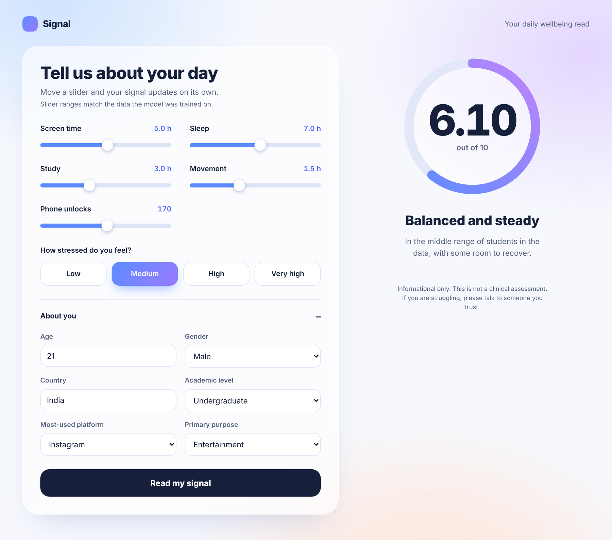

# Mental Health Signal

A web app that predicts a student's **mental health score (0 to 10)** from their social media use, sleep, study time, physical activity and stress level. Move a slider and the score updates on its own.

🔗 **Live demo:** https://mental-health-score-2-wh5b.onrender.com · 📄 **API docs:** https://mental-health-score-hv5r.onrender.com/docs

> The app runs on Render's free plan. If nobody has used it for a while, the first load can take 30–60 seconds while the server wakes up.



> Informational only. This is not a clinical assessment. If you are struggling, please talk to someone you trust.

---

## Features

- Live prediction: the score updates as you move any slider (requests are debounced by 300 ms, and stale responses are ignored)
- Five sliders (screen time, sleep, study, movement, phone unlocks), a stress selector, and an "About you" section
- Animated score ring with a short plain-language reading. The bands follow the quartiles of the score in the dataset, so they compare you with the students in the data:

  | Score | Reading | Share of students in the data |
  |---|---|---|
  | below 5.1 | "Strained right now" | bottom 24% |
  | 5.1 to 7.09 | "Balanced and steady" | middle 51% |
  | 7.1 and above | "Strong and resilient" | top 25% |
- Slider ranges match the range of the training data, so every slider position gives a real prediction
- Input validation on both the page (age, country) and the API (types, ranges, allowed values, and a check that sleep, study and activity fit in 24 hours)
- Friendly error messages if the server can't be reached, times out, or rejects an input (the API's reason is shown)
- A "waking up the server" message while the free Render server starts, with a 70-second timeout
- Respects the "reduce motion" setting of the operating system

## Tech stack

| Part | Tools |
|---|---|
| Model | Python, pandas, NumPy, scikit-learn (Random Forest inside a single Pipeline) |
| Backend | FastAPI, Pydantic, Uvicorn |
| Frontend | HTML, CSS, vanilla JavaScript |
| Hosting | Render (Web Service for the API, Static Site for the page) |

## How it works

```
Browser (index.html + script.js)
   │  POST /predict  (JSON, 12 fields)
   ▼
FastAPI (main.py)
   │  1. Pydantic validates the request
   │  2. Country is mapped to its group (top countries or "Other")
   │  3. Builds a one-row DataFrame with the training column names
   ▼
Mental_Health_Model.pkl  (preprocessing + Random Forest)
   │
   ▼
{ "predicted_mental_health_score": 6.1 }  →  score ring on the page
```

## Dataset

`Student_Social_Media_And_Mental_Health_Impact.csv`: 5,000 students and 13 columns (4,998 rows after removing 2 duplicates). No missing values.

| Column | Type | Range / values |
|---|---|---|
| Age | number | 18 to 24 |
| Gender | category | Male, Female |
| Country | category | 111 values, including a ready-made `Other` label (1,880 rows) |
| Academic_Level | category | High School, Undergraduate, Graduate |
| Most_Used_Platform | category | 12 platforms (Instagram, TikTok, Facebook, LinkedIn, YouTube, Twitter, Snapchat, WhatsApp, LINE, VKontakte, KakaoTalk, WeChat) |
| Purpose_Of_Use | category | Entertainment, Education, Networking, News |
| Avg_Daily_Usage_Hours | number | 1.0 to 8.8 |
| Daily_Unlocks | number | 62 to 273 |
| Study_Hours | number | 0.3 to 8.3 |
| Physical_Activity_Hours | number | -0.4 to 4.1 (10 negative values, clipped to 0) |
| Sleep_Hours_Per_Night | number | 3.6 to 9.9 |
| Stress_Level | category | Low, Medium, High, Very High |
| **Mental_Health_Score** (target) | number | 3.6 to 9.4 |

How each input relates to the score (Pearson correlation, after cleaning):

| Feature | Correlation with score |
|---|---|
| Avg_Daily_Usage_Hours | -0.82 |
| Daily_Unlocks | -0.79 |
| Stress_Level (0 = Low … 3 = Very High) | -0.78 |
| Sleep_Hours_Per_Night | +0.77 |
| Study_Hours | +0.75 |
| Physical_Activity_Hours | +0.52 |
| Age | +0.10 |

## How the model was built

The full work is in `ML_Project.ipynb`.

1. **Cleaning:** removed 2 duplicate rows and clipped impossible negative activity hours to 0.
2. **Feature engineering:** kept the 10 most frequent `Country` values and put everything else into `Other` (`Grouped_country`). Because the raw data already has an `Other` label as the most common value, this gives **9 named countries (India, USA, Canada, Australia, UK, Germany, Mexico, Turkey, France) plus `Other`**, which is 10 groups instead of 111.
3. **Preprocessing (one `ColumnTransformer`):**
   - `Study_Hours`: `log1p` transform, then scaling
   - Other numeric columns: scaling
   - `Stress_Level`: ordinal encoding (Low < Medium < High < Very High)
   - `Gender`, `Academic_Level`, `Most_Used_Platform`, `Purpose_Of_Use`, `Grouped_country`: one-hot encoding (unknown values are ignored)
4. **Models compared** on an 80/20 train/test split (`random_state=42`). The Random Forest was tuned with `RandomizedSearchCV` (15 combinations, 5-fold CV, `max_depth` including `None`).

| Model | 5-fold CV R² (train set) | Test R² | Test MAE | Test RMSE | Train R² |
|---|---|---|---|---|---|
| Baseline (always predict the mean) | – | 0.000 | 1.128 | 1.337 | – |
| Linear Regression | 0.721 ± 0.006 | 0.743 | 0.534 | 0.678 | 0.726 |
| **Random Forest (default, 100 trees)** | **0.865 ± 0.008** | **0.890** | **0.327** | **0.442** | 0.983 |
| Random Forest (tuned, 300 trees) | 0.866 ± 0.008 | 0.891 | 0.326 | 0.441 | 0.983 |

5. **Choosing the final model:** the model is chosen by cross-validation on the training set, not by the test set. The tuned and default forests are within 0.001 CV R² of each other, which is smaller than the noise between folds, so the notebook keeps the **default Random Forest**: it is 3 times smaller and uses about 110 MB less memory, which matters on the free 512 MB Render plan.

The final model cuts the average error by about 70% compared to the baseline. On average its prediction is off by about a third of a point on the 0 to 10 scale.

The whole pipeline (preprocessing and model) is saved as one compressed file, `Mental_Health_Model.pkl` (about 5.6 MB), so the API only calls `.predict()` on raw input. The API server uses about 250 MB of memory.

### What the model relies on

Feature importance from the saved Random Forest:

| Feature | Importance |
|---|---|
| Avg_Daily_Usage_Hours | 0.69 |
| Sleep_Hours_Per_Night | 0.10 |
| Daily_Unlocks | 0.05 |
| Study_Hours | 0.03 |
| Physical_Activity_Hours | 0.03 |
| Age | 0.02 |
| Stress_Level | 0.01 |
| All one-hot columns together | 0.09 |

Screen time does most of the work. Stress level has a strong link with the score, but it is also strongly linked with screen time (correlation 0.87), so the model mostly gets that information from screen time instead. See [Limitations](#limitations).

## Project structure

```
.
├── ML_Project.ipynb                                  # data analysis, training, evaluation
├── Student_Social_Media_And_Mental_Health_Impact.csv # dataset
├── Mental_Health_Model.pkl                           # saved scikit-learn pipeline (~5.6 MB)
├── main.py                                           # FastAPI backend
├── index.html                                        # web page
├── style.css                                         # styling
├── script.js                                         # page logic and API calls
├── requirements.txt                                  # API dependencies (used by Render)
├── requirements-notebook.txt                         # extra packages to run the notebook
├── .python-version                                   # Python version (3.12.3)
├── images/signal-ui.png                              # screenshot used in this README
└── README.md
```

## API

### `GET /`

```json
{ "message": "Welcome to Mental Health Scorer API" }
```

### `POST /predict`

Request body:

```json
{
  "age": 21,
  "gender": "Male",
  "country": "India",
  "academic_level": "Undergraduate",
  "most_used_platform": "Instagram",
  "purpose_of_use": "Entertainment",
  "avg_daily_usage_hours": 5,
  "daily_unlocks": 170,
  "study_hours": 3,
  "physical_activity_hours": 1.5,
  "sleep_hours_per_night": 7,
  "stress_level": "Medium"
}
```

Response:

```json
{ "predicted_mental_health_score": 6.1 }
```

| Field | Rule |
|---|---|
| `age` | whole number, 18 to 24 |
| `gender` | `Male` or `Female` |
| `country` | 1 to 60 characters; not case-sensitive; extra spaces are removed; anything outside the 9 named countries is treated as `Other` |
| `academic_level` | `High School`, `Undergraduate`, `Graduate` |
| `most_used_platform` | one of the 12 platforms listed in the dataset table |
| `purpose_of_use` | `Networking`, `Education`, `Entertainment`, `News` |
| `avg_daily_usage_hours`, `study_hours`, `physical_activity_hours`, `sleep_hours_per_night` | 0 to 24 |
| `daily_unlocks` | whole number, 0 to 1000 |
| `stress_level` | `Low`, `Medium`, `High`, `Very High` |
| sleep + study + physical activity | must add up to 24 hours or less |

An invalid request returns **422** with details of the field that failed. The returned score is always between 0 and 10.

Try it from the terminal:

```bash
curl -X POST https://mental-health-score-hv5r.onrender.com/predict -H "Content-Type: application/json" -d '{"age":21,"gender":"Male","country":"India","academic_level":"Undergraduate","most_used_platform":"Instagram","purpose_of_use":"Entertainment","avg_daily_usage_hours":5,"daily_unlocks":170,"study_hours":3,"physical_activity_hours":1.5,"sleep_hours_per_night":7,"stress_level":"Medium"}'
```

## Run locally

1. Install the dependencies (Python 3.12.3, the version in `.python-version`):
   ```bash
   pip install -r requirements.txt
   ```
2. Start the API:
   ```bash
   uvicorn main:app --port 8000 --reload
   ```
3. Check it at http://127.0.0.1:8000/docs
4. In `script.js`, change `API_BASE` to `http://127.0.0.1:8000`, then open `index.html` in your browser (or run `python -m http.server 5500` and visit http://localhost:5500)

The model was saved with **scikit-learn 1.9.0**, and all versions in `requirements.txt` are pinned. Keep them as they are, or the `.pkl` file may fail to load or give different results.

To retrain:

```bash
pip install -r requirements-notebook.txt
jupyter nbconvert --to notebook --execute --inplace ML_Project.ipynb
```

This runs every cell from top to bottom and writes a new `Mental_Health_Model.pkl` next to the notebook.

## Deploy on Render

- **Backend:** Web Service, build command `pip install -r requirements.txt`, start command `uvicorn main:app --host 0.0.0.0 --port $PORT`. Render reads the Python version from `.python-version`.
- **Frontend:** Static Site, no build command, publish directory `.`

Before pushing, set `API_BASE` in `script.js` back to the live backend URL.

## Limitations

- **The data looks synthetic.** All the lifestyle columns move together very strongly (for example screen time and phone unlocks have a correlation of 0.96). Results show patterns in this dataset, not proven facts about students.
- **Stress barely changes the score on its own.** Because stress is so closely tied to screen time in the data, the model learned to rely on screen time. Changing only the stress buttons usually moves the score by about 0.1.
- **No predictions outside the training range.** A Random Forest cannot extrapolate, so the website sliders stop at the training range. The API still accepts wider values (for example 12 hours of screen time), but they get the same score as the edge of the training range (8.8 hours).
- **Predictions stay away from the extremes.** A Random Forest averages many trees, so very low and very high scores get pulled toward the middle. Only 0.8% of students in the data score below 4, and the model almost never predicts below 4. This is why the result bands use the dataset quartiles (5.1 and 7.1) instead of fixed cut-offs like 4 and 7.
- **Some overfitting.** Train R² is 0.98 against 0.89 on the test set, which is normal for a default Random Forest. Limiting the tree depth lowered the CV score, so it was not used.
- **Limited inputs.** Gender only has the two values present in the data, and age is limited to 18 to 24.
- The scores show how well habits explain the scores in this dataset. They are not medical or psychological advice.
